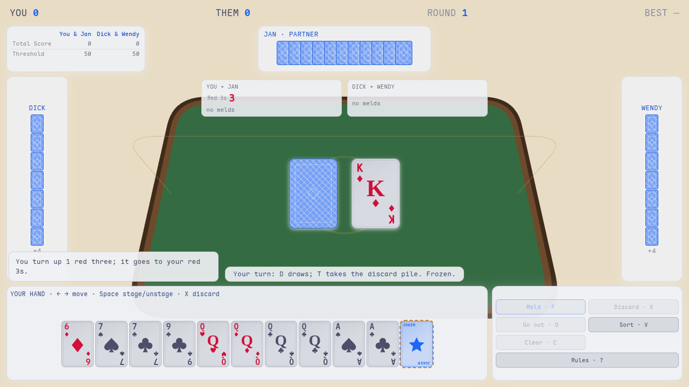
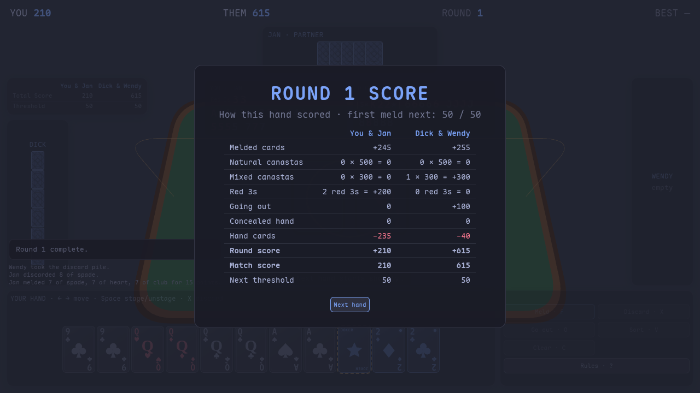

# Canasta for Omarchy Game Vibes

An original, single-file Classic Canasta game for Omarchy Game Vibes. Play four-handed partnership Canasta against three bots, with rule explanations when a move is not allowed.



## Install

```bash
omarchy games vibes install https://github.com/whelanh/omarchy-canasta-game.git
```

Or open the Game Vibes menu, choose **Install > Gaming > Game Vibes**, and paste the URL. The repo name normalizes to the installed game name `canasta`.

## Controls

- `←` / `→`: move through your hand
- `Space` / `Enter`: stage or unstage a card
- `D`: draw from the stock
- `T`: take the discard pile
- `F`: meld staged cards, or add them to your team's matching meld
- `X`: discard the selected card (the button names it)
- `O`: go out (meld the rest, or all but one and discard)
- `V`: sort your hand · `C`: clear staged cards
- `Esc` / `P`: pause · `Q`: back to Game Vibes
- `?`: help

Click any of your team's melds to add the staged cards to it.

## Rules

This is the Classic Canasta variant: two decks plus four jokers, partnerships, 11-card hands, first-meld thresholds, frozen and blocked piles, red-three bonuses, Canastas, going out, and play to 5,000 points. The game explains illegal moves such as blocked pile pickups, insufficient first melds, invalid meld composition, and discarding a card that could be laid off.

Melds show coloured ranks, with jokers as stars and wildcards on the right; a canasta of seven or more cards shows a count. Taking the discard pile automatically uses the cards it needs from your hand — two matching natural cards, or one match and a wild when the pile is not frozen — and can add the top card to your team's matching meld. Stage cards first to choose them yourself. The stock and discard piles sit in the middle of the table and show only their cards — no counts — so you have to keep track, as at a real table.

The left score table shows each team's total and first-meld threshold. A scorecard appears after every hand with the full scoring breakdown; close it to deal the next hand. Red 3s are laid aside and replaced immediately after the deal and show in the team row, and the opening deal and opponent melds are animated. The first hand starts with a random player, and the turn rotates after each hand.



No build step, local assets, or `fetch()` calls are used. three.js is pinned from a CDN, and the game runs directly from `file://` as Game Vibes requires.

## License

MIT. See [LICENSE](LICENSE).
